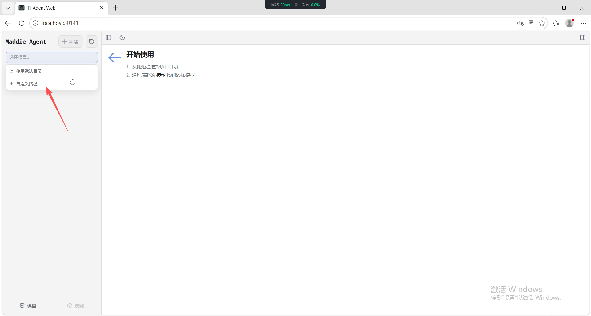
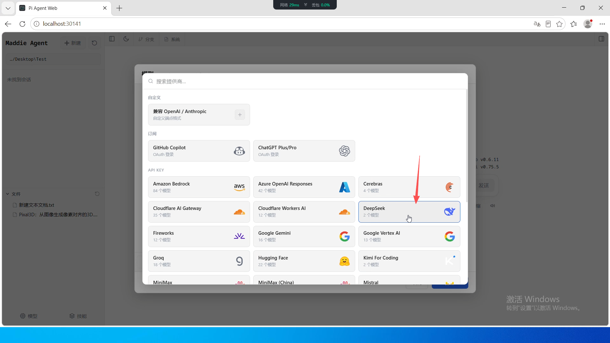
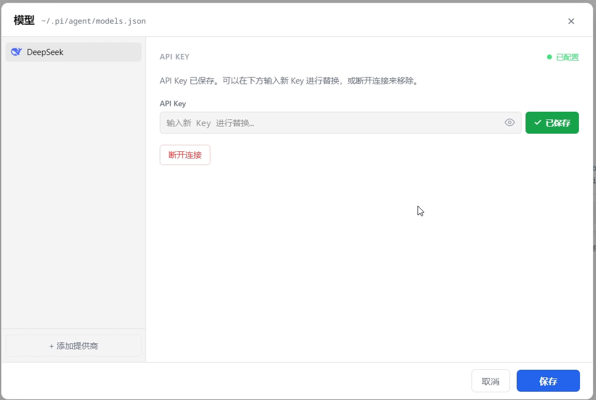
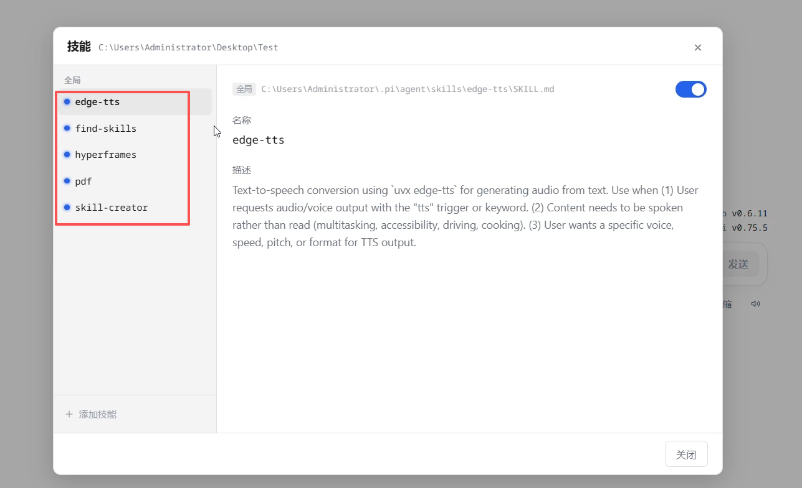
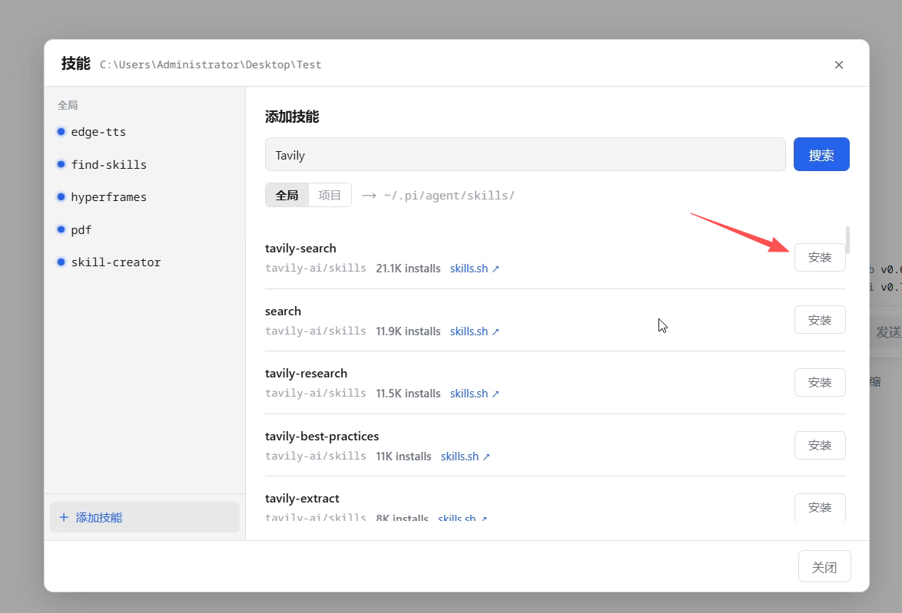
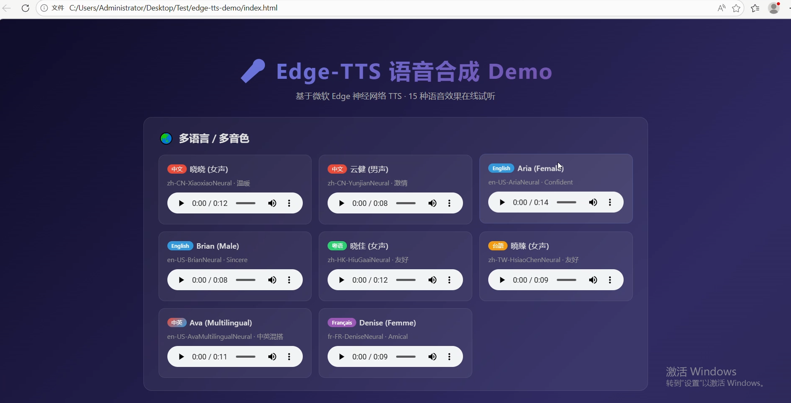
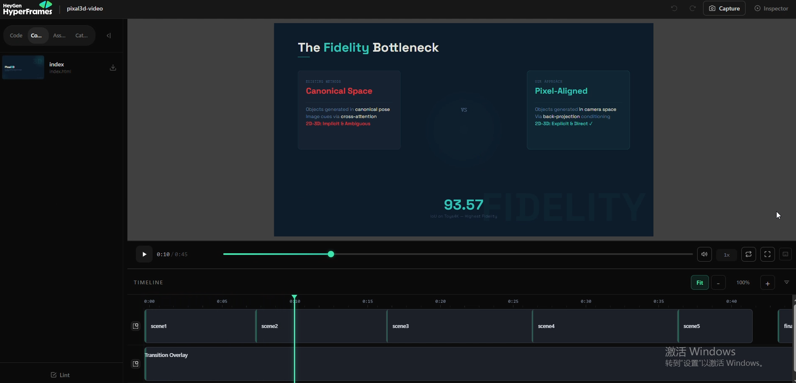
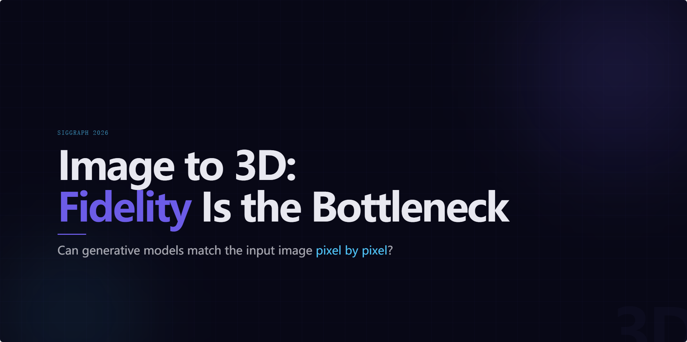

# Maddie Agent 图文使用指南

[返回 README](../README.md)

本指南使用用户提供的旧版截图（部分显示 `v0.6.11`）。当前版本的登录授权、启动方式请先阅读 README；界面名称、提供商列表和技能数量以实际版本为准。截图中的测试目录仅作示例，请选择自己的工作目录。

## 1. 选择工作目录

启动并登录后，在左侧项目选择框中使用默认目录，或通过“自定义路径”选择工作目录。Agent 会在所选目录中处理文件。

## 2. 配置模型

点击侧边栏底部的“模型”，选择“添加提供商”，然后选择要使用的服务。下图以 DeepSeek 为例。

在提供商的 API Key 输入框填写自己的密钥，点击输入框旁的“保存”。出现“已配置”或“已保存”后，再保存模型面板中的其他配置并关闭面板。在聊天输入框下方选择模型，即可开始对话。

请在专用配置输入框中填写密钥，不要将真实密钥发送到聊天、粘贴到教程或提交到仓库。

## 3. 查看和安装技能

点击侧边栏底部的“技能”，选择一个技能可查看说明，并通过右上角开关启用或禁用。

点击“添加技能”，输入关键词并搜索，选择全局或项目安装范围，再点击对应结果的“安装”。安装前确认技能来源和用途；已有同名技能时无需重复安装。

Tavily 搜索还需要自己的 API Key。使用源码启动脚本时，可按 README 将 `config/tavily-api-key.example.txt` 复制为 `config/tavily-api-key.txt`，在第一行填写密钥后重新启动。真实密钥文件不要提交或分发。

## 4. 生成语音示例

启用 edge-tts 后，可以发送这样的请求：

> 使用 edge-tts 创建一个语音演示，在新文件夹中生成中文和英文示例音频，并制作一个本地试听页面。

下图是生成的试听页面示例，实际语言、音色及文件数量取决于请求和执行结果。

## 5. 制作视频示例

启用相关技能后，可以先让 Agent 阅读工作目录中的 PDF 并总结，再请求制作介绍动画：

> 根据刚才的论文总结，使用 HyperFrames 制作一段介绍动画，将文件放入单独的文件夹，并提供预览方式。

HyperFrames 项目应按 Agent 提供的预览方式打开；直接双击 HTML 文件不一定能播放动画。下图展示在 HyperFrames 中查看画面和时间轴。

下图为生成动画的一帧。截图仅展示作品效果，不代表已经导出视频文件，也不用于验证画面中的论文结论。

